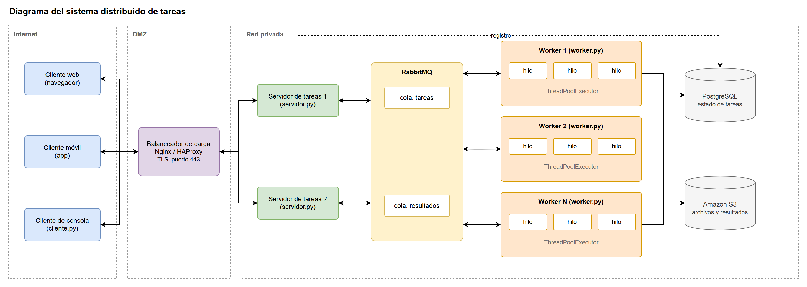
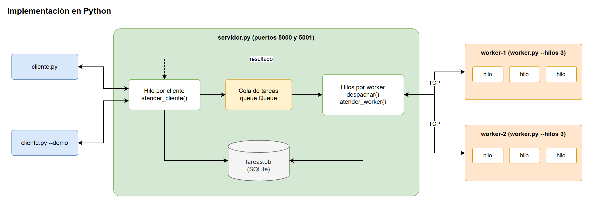
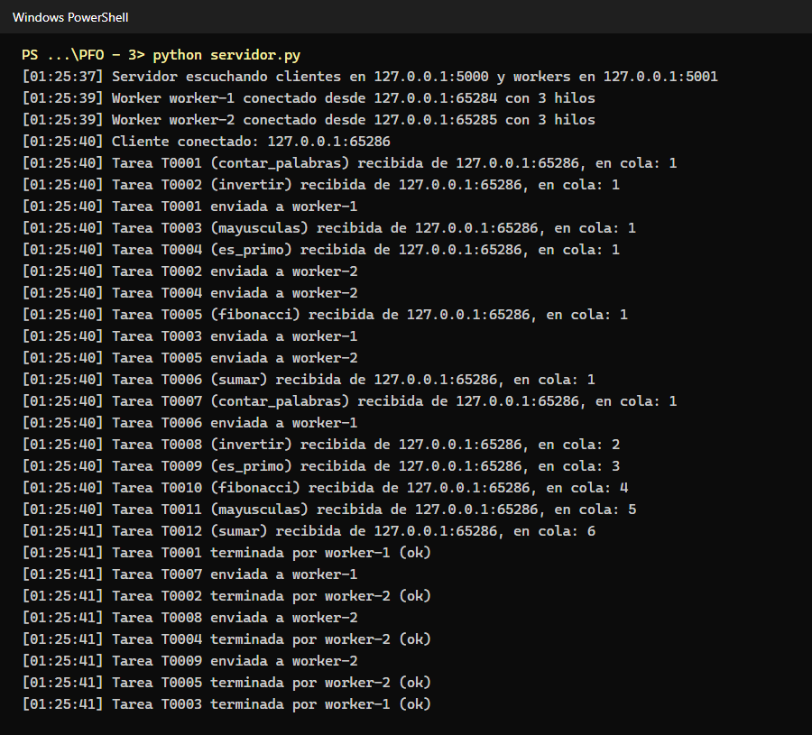
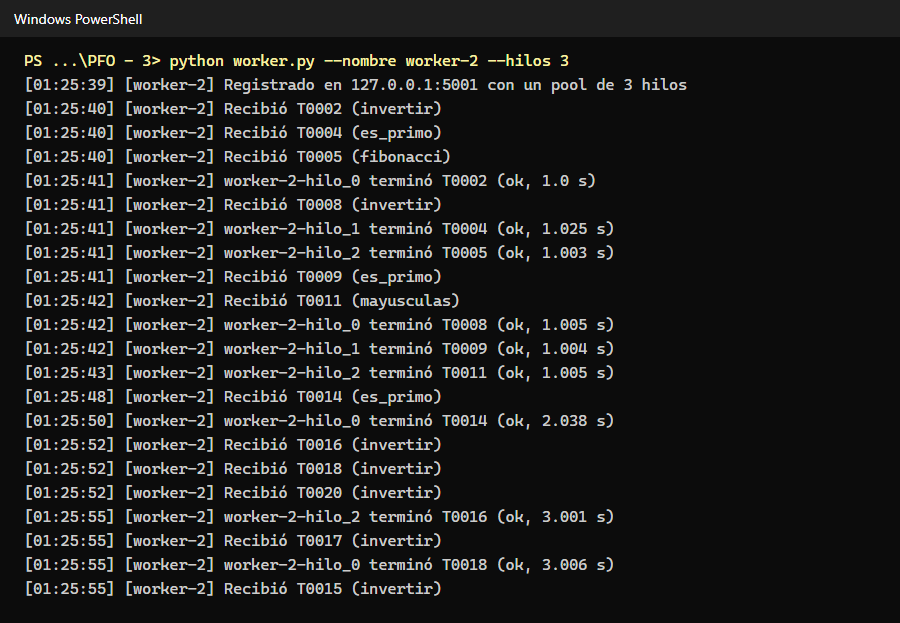
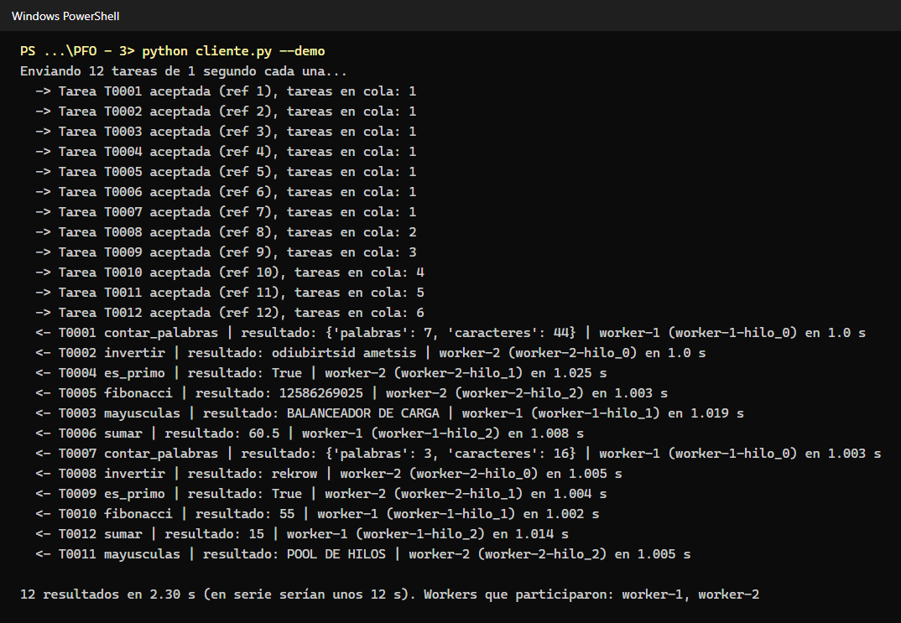
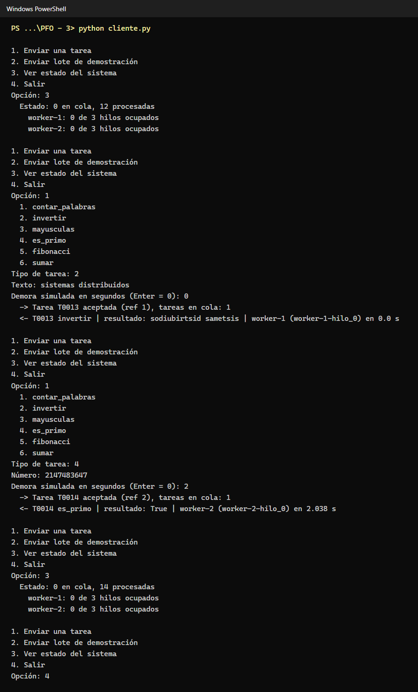
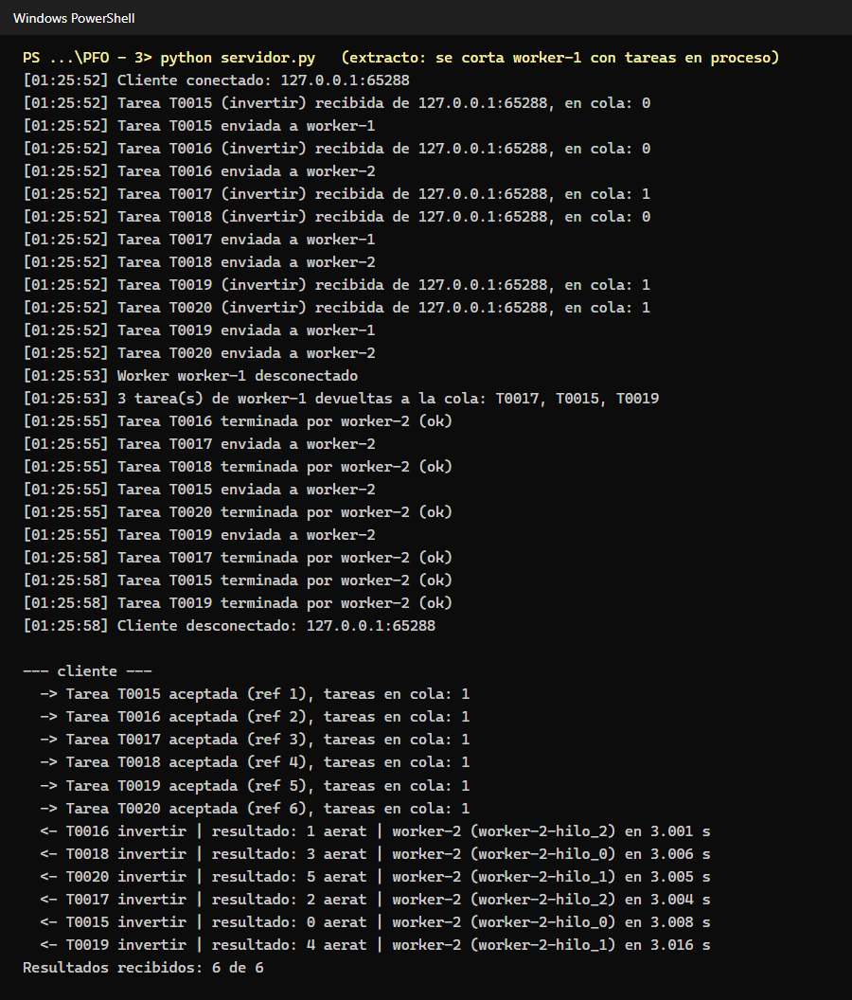
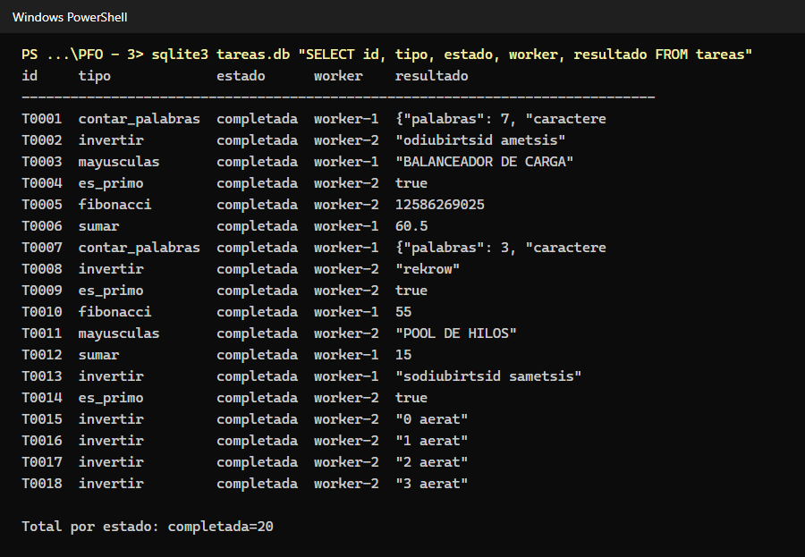
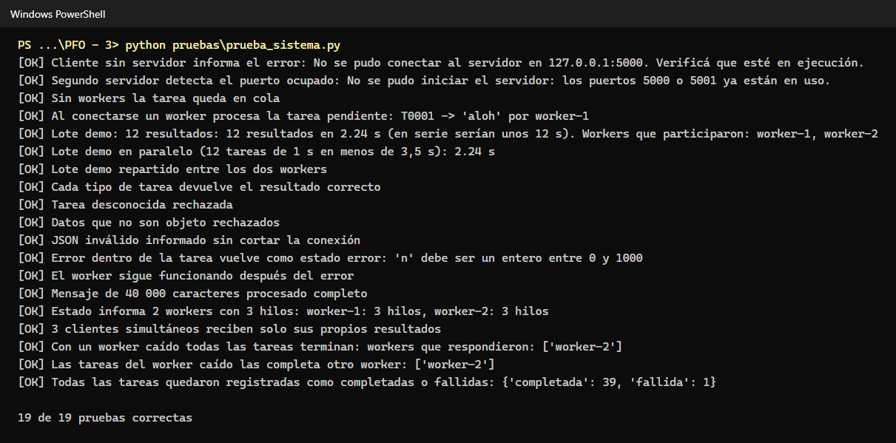

# PFO 3: Rediseño como Sistema Distribuido (Cliente-Servidor)

**Programación sobre Redes** · Tecnicatura Superior en Desarrollo de Software · IFTS N.° 29
Alumno: Fernando Rodriguez · 5.° Cuatrimestre · 2026

Documentación publicada: https://ferchulobo777.github.io/pfo3-sistema-distribuido/

## Tabla de contenidos

1. [Descripción](#descripción)
2. [Diagrama del sistema](#diagrama-del-sistema)
3. [Implementación](#implementación)
4. [Protocolo de comunicación](#protocolo-de-comunicación)
5. [Tareas disponibles](#tareas-disponibles)
6. [Requisitos](#requisitos)
7. [Ejecución](#ejecución)
8. [Pruebas](#pruebas)
9. [Estructura del proyecto](#estructura-del-proyecto)
10. [Decisiones de diseño](#decisiones-de-diseño)
11. [Limitaciones y mejoras posibles](#limitaciones-y-mejoras-posibles)

## Descripción

Sistema de procesamiento de tareas con arquitectura distribuida basada en sockets TCP. Un servidor recibe tareas de varios clientes, las encola y las reparte entre procesos workers independientes; cada worker resuelve varias tareas a la vez con su propio pool de hilos y devuelve el resultado, que el servidor reenvía al cliente que hizo el pedido.

Consigna de la cátedra:

1. Diseñar un diagrama con clientes (móviles, web), balanceador de carga (Nginx/HAProxy), servidores workers con pool de hilos, cola de mensajes (RabbitMQ) y almacenamiento distribuido (PostgreSQL, S3).
2. Implementar en Python un servidor que reciba tareas por socket y las distribuya a workers, y un cliente que envíe tareas y reciba resultados.

## Diagrama del sistema



| Componente | Función |
| --- | --- |
| Clientes web, móvil y de consola | Envían tareas y reciben resultados. Desde Internet solo llegan al balanceador. |
| Balanceador de carga (Nginx/HAProxy) | Único punto expuesto (443). Termina TLS, reparte las conexiones entre servidores (round robin) y deja de enviar a un servidor que no responde el chequeo de salud. |
| Servidores de tareas | Validan cada tarea, le asignan un identificador, la registran en PostgreSQL y la publican en la cola. No guardan estado propio, por eso se pueden replicar. |
| RabbitMQ | Desacopla servidores y workers. La cola `tareas` es durable y usa confirmación manual (ack): si un worker se cae antes de confirmar, la tarea vuelve a la cola. Los resultados vuelven por una cola por servidor. |
| Workers con pool de hilos | Consumen tareas de la cola. Cada uno toma tantas tareas como hilos tiene (prefetch) y se pueden agregar workers según la carga. |
| PostgreSQL | Estado de cada tarea y resultados chicos. Primario con réplica. |
| Amazon S3 | Archivos de entrada y resultados grandes, que no conviene mover por la cola. |

El archivo editable está en `docs/diagramas/diagrama-sistema.drawio` (se abre con https://app.diagrams.net).

## Implementación



El código implementa el núcleo del diagrama con la biblioteca estándar de Python, sin instalar RabbitMQ ni PostgreSQL. Cada parte cumple el mismo rol:

| En el diagrama | En el código |
| --- | --- |
| Cliente | `cliente.py`: menú de consola y modo `--demo` |
| Servidor de tareas | `servidor.py`: un hilo por cliente (puerto 5000) y uno por worker (puerto 5001) |
| RabbitMQ | `queue.Queue` dentro del servidor, segura entre hilos |
| Prefetch y ack | Un semáforo por worker con el tamaño de su pool; las tareas sin resultado de un worker caído vuelven a la cola |
| Worker con pool de hilos | `worker.py` con `concurrent.futures.ThreadPoolExecutor` |
| PostgreSQL | `tareas.db` (SQLite) con el estado de cada tarea |

Funcionamiento:

1. El worker se conecta al puerto 5001 y se registra con su nombre y la cantidad de hilos.
2. El cliente se conecta al puerto 5000 y envía tareas sin esperar la respuesta de la anterior.
3. El hilo del cliente valida la tarea, le asigna un id (`T0001`, `T0002`...), la guarda como `pendiente` y la pone en la cola.
4. Cada worker tiene un hilo despachador en el servidor que, cuando el worker tiene un hilo libre, toma la siguiente tarea de la cola y se la envía. Como todos los despachadores consumen de la misma cola, cada tarea va al primer worker que se libera.
5. El worker la resuelve en un hilo de su pool y devuelve el resultado.
6. El servidor actualiza la base y reenvía el resultado al cliente que la pidió. Los resultados pueden llegar en otro orden que los pedidos.
7. Si un worker se desconecta, sus tareas en proceso vuelven a la cola y las termina otro.

## Protocolo de comunicación

Todos los mensajes son objetos JSON en una línea terminada en `\n` (`protocolo.py`). El salto de línea marca el fin de cada mensaje: TCP entrega un flujo de bytes y una lectura puede traer medio mensaje o dos juntos, así que se lee con `makefile().readline()` hasta completar la línea. Así se procesan mensajes de cualquier largo, no solo de 1024 bytes.

| Dirección | Mensaje |
| --- | --- |
| cliente → servidor | `{"tipo": "tarea", "tarea": "invertir", "datos": {"texto": "hola"}, "ref": "1"}` |
| servidor → cliente | `{"tipo": "aceptada", "id": "T0001", "ref": "1", "en_cola": 0}` |
| servidor → cliente | `{"tipo": "resultado", "id": "T0001", "ref": "1", "estado": "ok", "resultado": "aloh", "worker": "worker-1", "hilo": "worker-1-hilo_0", "duracion": 0.001}` |
| cliente → servidor | `{"tipo": "estado"}` (devuelve workers conectados, hilos ocupados y tareas en cola) |
| worker → servidor | `{"tipo": "registro", "nombre": "worker-1", "hilos": 3}` |
| servidor → worker | `{"tipo": "tarea", "id": "T0001", "tarea": "invertir", "datos": {"texto": "hola"}}` |
| worker → servidor | `{"tipo": "resultado", "id": "T0001", "estado": "ok", "resultado": "aloh", "hilo": "worker-1-hilo_0", "duracion": 0.001}` |

Los errores vuelven como `{"tipo": "error", "detalle": "..."}` (tarea desconocida, datos inválidos, JSON mal formado) o como resultado con `"estado": "error"` si la tarea falla dentro del worker. En ningún caso se corta la conexión.

## Tareas disponibles

| Tarea | Datos | Resultado |
| --- | --- | --- |
| `contar_palabras` | `{"texto": "..."}` | `{"palabras": n, "caracteres": n}` |
| `invertir` | `{"texto": "..."}` | texto invertido |
| `mayusculas` | `{"texto": "..."}` | texto en mayúsculas |
| `es_primo` | `{"numero": n}` (0 a 10^12) | `true` o `false` |
| `fibonacci` | `{"n": n}` (0 a 1000) | n-ésimo número de Fibonacci |
| `sumar` | `{"numeros": [...]}` | suma |

Todas aceptan `"demora"` (segundos, máximo 10) para simular una tarea larga y observar el procesamiento en paralelo.

## Requisitos

- Python 3.8 o superior. No requiere dependencias externas: solo biblioteca estándar (`socket`, `threading`, `queue`, `concurrent.futures`, `sqlite3`, `json`).

## Ejecución

Abrir una terminal por proceso, en la carpeta del proyecto:

```
python servidor.py
python worker.py --nombre worker-1 --hilos 3
python worker.py --nombre worker-2 --hilos 3
python cliente.py
```

El cliente muestra un menú para enviar una tarea, enviar un lote de demostración, ver el estado del sistema o salir. Para enviar directamente el lote de 12 tareas:

```
python cliente.py --demo
```

Se pueden levantar más workers o más clientes en cualquier momento. Para usar workers en otras máquinas, cambiar `HOST` en `servidor.py` y `worker.py` por la IP del servidor y abrir el puerto 5001 en el cortafuegos.

## Pruebas

`pruebas/prueba_sistema.py` levanta procesos reales (servidor, dos workers y varios clientes) sobre una copia del proyecto en una carpeta temporal y verifica 19 casos:

```
python pruebas/prueba_sistema.py
```

| Caso | Resultado esperado |
| --- | --- |
| Cliente sin servidor | Mensaje claro, sin traza de error |
| Segundo servidor en los mismos puertos | Detecta el puerto ocupado |
| Tarea sin workers conectados | Queda en cola y se procesa cuando se conecta un worker |
| Lote de 12 tareas de 1 s con 2 workers de 3 hilos | 12 resultados en unos 2,2 s (en serie serían 12 s), repartidos entre los dos workers |
| Cada tipo de tarea | Resultado correcto |
| Tarea desconocida, datos inválidos, JSON roto | Error informado, la conexión sigue abierta |
| Tarea que falla en el worker | Vuelve con estado `error` y el worker sigue funcionando |
| Mensaje de 40 000 caracteres | Se procesa completo |
| 3 clientes simultáneos | Cada uno recibe solo sus resultados |
| Se cae un worker con tareas en proceso | Las tareas vuelven a la cola y las completa el otro worker |
| Base de datos | Todas las tareas terminan como `completada` o `fallida` |

Resultado: 19 de 19 pruebas correctas, en Windows 11 con Python 3.9.

### Capturas

Servidor recibiendo tareas y repartiéndolas entre los workers:



Worker procesando tareas en los hilos de su pool:



Cliente en modo demostración: 12 tareas de 1 segundo resueltas en unos 2 segundos:



Cliente interactivo:



Caída de un worker con tareas en proceso: el servidor las devuelve a la cola y las completa el otro worker:



Registro de las tareas en la base de datos:



Pruebas automatizadas:



## Estructura del proyecto

| Archivo | Contenido |
| --- | --- |
| `servidor.py` | Recibe tareas de los clientes, las encola, las reparte entre workers y devuelve los resultados |
| `worker.py` | Nodo de procesamiento con pool de hilos |
| `cliente.py` | Cliente de consola (menú y modo `--demo`) |
| `protocolo.py` | Envío y lectura de mensajes JSON delimitados por salto de línea |
| `tareas.py` | Catálogo de tareas que ejecutan los workers |
| `pruebas/prueba_sistema.py` | Pruebas de extremo a extremo |
| `docs/diagramas/` | Diagramas en PNG y en formato draw.io |
| `docs/capturas/` | Capturas de las pruebas |
| `docs/index.html` | Sitio publicado con GitHub Pages |
| `tareas.db` | Base SQLite (se crea al iniciar el servidor, no se versiona) |

## Decisiones de diseño

- **Workers como procesos separados conectados por socket**, no hilos dentro del servidor: así el sistema es distribuido de verdad (un worker puede correr en otra máquina) y un error en un worker no afecta al servidor.
- **Pool de hilos en el worker** (`ThreadPoolExecutor`) en lugar de un hilo por tarea: la cantidad de hilos queda acotada aunque lleguen muchas tareas.
- **El worker se conecta al servidor** (y no al revés): se pueden sumar workers sin reconfigurar el servidor, igual que los consumidores de RabbitMQ.
- **Semáforo por worker**: el servidor nunca le envía más tareas que hilos libres, equivalente al prefetch de RabbitMQ. La carga se reparte según la disponibilidad real de cada worker y no por turnos fijos.
- **Reencolado ante fallas**: el servidor sabe qué tareas tiene cada worker; si la conexión se corta, las devuelve a la cola, como el ack manual de RabbitMQ.
- **Locks en los datos compartidos**: la cola es `queue.Queue` (segura entre hilos), las tareas en curso y los contadores se modifican con `threading.Lock`, cada socket tiene un lock de escritura para que dos hilos no mezclen sus mensajes, y las escrituras en SQLite se serializan.
- **Sin `SO_REUSEADDR`**: en Windows esa opción permite que dos procesos escuchen el mismo puerto sin error; sin ella, un segundo servidor falla y se informa el puerto ocupado.

Durante las pruebas apareció una condición de carrera: el servidor marcaba la tarea como `en_proceso` después de enviarla, y si el worker respondía muy rápido el estado `completada` quedaba pisado. Se corrigió marcando el estado antes del envío.

## Limitaciones y mejoras posibles

- La cola vive en la memoria del servidor: si el servidor se reinicia se pierden las tareas pendientes. Con RabbitMQ (cola durable) o recuperando las tareas `pendiente` de la base al iniciar se resolvería.
- Un solo servidor: para tener varios, como en el diagrama, la cola y la base tienen que estar fuera del servidor (RabbitMQ y PostgreSQL) y adelante un balanceador.
- Sin autenticación ni cifrado: en una red real habría que usar TLS (módulo `ssl`) entre todos los nodos y autenticar a los workers para que nadie pueda registrarse como uno.
- Los hilos sirven para tareas de entrada y salida; para cálculos pesados conviene `ProcessPoolExecutor` en el worker por el GIL de Python.
- Sin límite de tareas por cliente: habría que limitar la tasa de pedidos para evitar que un cliente sature el sistema.
